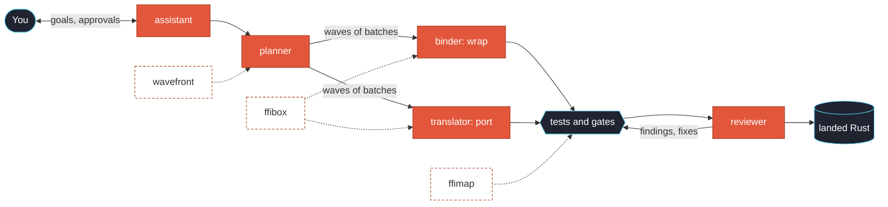

<p align="center">
  
</p>

<h1 align="center">Crustify</h1>

<p align="center">
  <b>Your AI co-translator for automating C-to-Rust work.</b>
</p>

<p align="center">
  <a href="https://arxiv.org/abs/2611.10394"></a>
  
  
  
  
  
</p>

<p align="center">
  <a href="#why-crustify">Why</a> ·
  <a href="#results">Results</a> ·
  <a href="#installation">Install</a> ·
  <a href="#usage">Usage</a> ·
  <a href="#how-it-works">How it works</a> ·
  <a href="docs/translate.md">Translation guide</a> ·
  <a href="docs/audit.md">Audit guide</a> ·
  <a href="https://arxiv.org/abs/2611.10394">Paper</a>
</p>

---

Crustify is a plugin for Claude Code and Codex that turns LLMs into specialized
translators that plan, run and review whole-repository campaigns. It can:

| 🛡️ Wrap | 🦀 Port | 🔍 Audit |
|:---:|:---:|:---:|
| **Generate safe Rust bindings over C** | **Migrate C to safe Rust** | **Audit Rust for UB and memory-safety bugs** |
| [Translation guide](docs/translate.md) | [Translation guide](docs/translate.md) | [Audit guide](docs/audit.md) |

You set the goals and a few settings; Crustify does the rest, on its own or with you in
the loop.

## Why Crustify

- 📜 **Follows a specification, not only a prompt.** A generic, human-reviewed specification
  describes how the work is done.
- 📦 **Takes a whole repository.** It breaks the repository into small workloads and
  processes them in parallel.
- ⚙️ **Is grounded in deterministic tools:**
  [wavefront](https://github.com/crustify-rs/wavefront),
  [ffibox](https://github.com/crustify-rs/ffibox) and
  [ffimap](https://github.com/crustify-rs/ffimap).
- ✅ **Validates everything before it lands,** with coverage-guided tests and adversarial
  review.
- 🎚️ **Lets you choose its autonomy.** It runs on its own, or it waits for your approval at
  the points you name.
- 🔌 **Runs on any agent harness, under any billing.**
- 💰 **Tracks cost** for each batch, module and campaign.
- 🔁 **Improves itself as it works.** Each change to its specification or its tools is
  validated and reviewed before it lands.

Each kind of campaign has a short guide to why to run it with Crustify, and how:

| campaign | guide | offers |
|---|---|---|
| generate bindings (`wrap`) or migrate C (`port`) | [Translating C to Rust](docs/translate.md) | planning, parallel batches, tests and regression gates with every batch, adversarial review, shipping with your approval |
| audit an existing crate | [Auditing a Rust crate](docs/audit.md) | objectives for each bug class, proof under Miri and the sanitizers, optional fixing, regression checks, disclosure drafts, a spending cap |

## Results

Crustify generated safe bindings for two libraries, with little guidance from one developer
overseeing it, as our [paper](https://arxiv.org/abs/2611.10394) details. Binder and reviewer
agents mainly ran Claude Opus 5.5; GPT-6.1 Sol and GPT-6 Astra wrapped a few modules, and
Claude Fable 5.1 ran the early reviews.

<table align="center">
  <tr>
    <td align="center"><h3>1,053</h3>public API items wrapped</td>
    <td align="center"><h3>≥ 98.9%</h3>Rust line coverage</td>
    <td align="center"><h3>≤ 1.6%</h3><code>unsafe</code> public API</td>
    <td align="center"><h3>21</h3>UB defects fixed in review</td>
  </tr>
</table>

| | [libgit2](https://github.com/crustify-rs/libgit2-crustify) | [FFmpeg](https://github.com/crustify-rs/ffmpeg-crustify) |
|---|---:|---:|
| Public API wrapped | 480 of 1,146 items (41.9%) | 573 of 1,338 items (42.8%) |
| Wall-clock time | 51.9 h | 58.9 h |
| Cost | $2,308 | $2,120 |
| `unsafe` public API (consumer-facing) | 42 of 2,663 functions (1.6%) | 11 of 2,637 functions (0.4%) |
| Raw pointers in public API (consumer-facing) | 2 functions (0.1%) | 16 functions (0.6%) |
| Tests: unit / equivalence / UB | 787 / 489 / 788 | 968 / 723 / 1,003 |
| Line coverage, Rust / C | 98.9% / 46.0% | 99.1% / 67.2% (`libavutil`) |
| UB defects the reviewers fixed | 8 | 13 |
| Rust LoC | ~18K | ~19K |

Each repository holds the code, the campaign's plan, its review reports and its
dashboard.

## Installation

Crustify runs on 64-bit Linux and translates targets built there, against glibc. It needs
Claude Code or Codex, and Python 3.13. Clone the components side by side and install the
tools, each on its `devel` branch, from which each campaign forks its working branch;
`ffibox` is a crate the
generated Rust depends on, so it is only cloned.

```bash
git clone https://github.com/crustify-rs/crustify.git
git clone --branch devel https://github.com/crustify-rs/wavefront.git
git clone --branch devel https://github.com/crustify-rs/ffibox.git
git clone --branch devel https://github.com/crustify-rs/ffimap.git

python -m pip install -e wavefront -e ffimap
```

> [!TIP]
> To skip the setup, [`templates/docker/`](templates/docker/README.md) builds an image with
> everything a campaign needs: both agent CLIs, CodeQL, bindgen, Miri and the sanitizer
> toolchains.

## Usage

Open Crustify's assistant in the directory a campaign is to work in. Pick your harness:

<details open>
<summary><b>Claude Code</b></summary>

```bash
claude --plugin-dir /path/to/crustify --agent crustify:assistant-translate   # wrap or port
claude --plugin-dir /path/to/crustify --agent crustify:assistant-audit       # audit
```

</details>

<details>
<summary><b>Codex</b></summary>

Install the agent roles and the assistant's profiles once, then open a profile:

```bash
python3 /path/to/crustify/providers/codex/install.py    # add --model-proxy openrouter --model <model> for OpenRouter
codex --profile crustify-translate                      # or crustify-audit
```

Trust the plugin's hook once with `/hooks`, and rerun the installer after the checkout
changes. The installer warns when Codex's sandbox cannot start on the host; `--sandbox
full` is for a container.

</details>

<details>
<summary><b>Other agent harnesses</b></summary>

[`providers/generic/compose.py`](providers/generic/compose.py) prints each agent's whole
prompt, with an index of the skills, for any harness that can run shell commands, edit
files and spawn sub-agents:

```bash
python3 /path/to/crustify/providers/generic/compose.py assistant translate   # or: assistant audit
python3 /path/to/crustify/providers/generic/compose.py binder                # planner, binder, translator, reviewer
```

Run the assistant's prompt as the main agent's, and register each stage's prompt as a
sub-agent it can spawn. Agents read the skills from the checkout, by the paths the
prompts name.

</details>

### Running a campaign

Tell the assistant what you want in plain language: wrap the public API, port the
parser, audit the crate. It asks what it needs, such as the revision, the models and how
much autonomy it has, and presents a campaign brief for your approval before it changes
anything. To answer up front, fill in a settings template,
[`templates/translate/`](templates/translate/CRUSTIFY.template.md) or
[`templates/audit/`](templates/audit/CRUSTIFY.template.md). The settings live in the
campaign's repository as `crustify/CRUSTIFY.md`, which you can edit while it runs.

The guides give the steps of each kind of campaign and where its results land:
[Translating C to Rust](docs/translate.md) and [Auditing a Rust crate](docs/audit.md).

## How it works

Every agent follows the same written specification, as skills: how the codebase is
decomposed, how each kind of C item becomes Rust, and how work is tested, reviewed and
landed. Runs are consistent across models and reproducible, and you don't reinvent the
workflow for each codebase.



Crustify's assistant talks to you and launches four kinds of agent:

| Agent | Role |
|---|---|
| 🤖 **assistant** | Configures the campaign, prepares builds and test baselines, launches the other agents, lands and promotes their work, and keeps the dashboard. |
| 🗺️ planner | Decomposes the codebase into modules, one per translation unit, and schedules them into waves by their dependencies. |
| 🛡️ binder | Wraps a batch: keeps its C and puts a safe Rust API in front of it. |
| 🦀 translator | Ports a batch to safe Rust. |
| 🔍 reviewer | Reviews what a wave landed, or an audited crate, for undefined behavior, unsafe contracts, equivalence with the C and the other review objectives, files a report and reproducer per finding, and fixes it when asked. |

Agents run in parallel. Each works in its own Git worktree and sees only its own batch.
Every batch gets coverage-guided tests for equivalence with the C, and for undefined
behavior under ASan, UBSan, TSan, MSan, Miri and BorrowSanitizer. Where a batch changes C,
it also passes the target's own test suite before it lands. Independent, adversarial
reviewers then check each wave before its dependents start. The assistant reconciles the
results and repairs what fails.

An audit runs the reviewers alone over an existing crate, for every review objective that
its settings select and within a spending cap. It drafts disclosures and never sends one.

Deterministic tools ground the agents' judgement:

- [wavefront](https://github.com/crustify-rs/wavefront) sorts the C codebase into
  dependency-ordered waves from CodeQL facts;
- [ffibox](https://github.com/crustify-rs/ffibox) provides the owners and handles the
  generated Rust holds C memory through; and
- [ffimap](https://github.com/crustify-rs/ffimap) measures the unsafe and FFI surface per
  batch, wave, module and campaign.

You choose how much control to keep. Run a campaign end to end, or approve its brief,
plan one module and stop, and decide as questions come up. To change course, edit its
settings mid-campaign. Each stage runs on Claude Code, Codex or any other agent harness,
with its own model, under a subscription or an API key, directly or through OpenRouter. A
dashboard tracks tokens, cost and time for each batch, module and campaign, next to
coverage and the unsafe surface.

Crustify also evolves from what its campaigns expose. An agent that meets a defect or a
missing rule in the specification or a tool files a proposal. You set how far a campaign
may act on its proposals: not at all, by proposing only, by repairing defects, or by
making improvements too. Each change is validated and reviewed by another agent before it
lands, and reaches `devel` only with your approval.

## Repository

- [`skills/`](skills/): the specification, one skill per part of a campaign, from its
  workflow and planning, through the generated Rust and its verification, to its
  operations, artifacts and tools
- [`agents/`](agents/): each agent's role, workflow and inputs
- [`providers/`](providers/): each host's composition of the agents:
  [`claude/`](providers/claude/), [`codex/`](providers/codex/), and
  [`generic/`](providers/generic/compose.py), which prints an agent's whole prompt for any
  other host
- [`templates/`](templates/README.md): the settings and dashboard templates, an example
  of each artifact, and the Dockerfile
- [`docs/`](docs/): a guide to each kind of campaign, [translation](docs/translate.md)
  and [audit](docs/audit.md)
- [`GOALS.md`](GOALS.md) and [`EVOLUTION.md`](EVOLUTION.md): what Crustify is for, and the
  record of how it has changed

## Maintainers

- Marius Momeu, University of California, Berkeley

## Citation

```bibtex
@misc{momeu2026crustify,
  title         = {Crustify: Repository-Level Generation of Safe Rust Bindings with {LLM} Agents and Coverage-Guided Testing},
  author        = {Momeu, Marius and Arvinte, Marius and Cornelius, Cory and Sen, Koushik},
  year          = {2026},
  eprint        = {2611.10394},
  archivePrefix = {arXiv},
  primaryClass  = {cs.PL},
  url           = {https://arxiv.org/abs/2611.10394}
}
```
